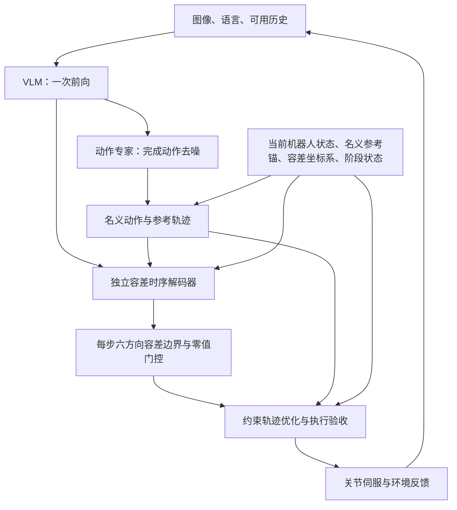

# 容差任务的架构与数据流建议

日期：2026-11-10。状态：**设计建议，尚未实施或实验验证**。没有启动训练、测评、数据重标注或服务器任务。

## 推荐方案

采用“名义动作生成 → 动作条件容差预测 → 显式约束执行”的单向结构。容差模块是独立时序解码器；先使用小型模型，保留扩展为完整 Transformer expert 的接口。

研究对象是：给定当前任务上下文与名义动作，学习下游控制器可以使用的六方向旋转容差参数，并用显式机器人约束分配实际姿态偏离。架构规模与是否采用 18 层 MoT 由匹配对照决定。

这里对 T-RO 的判断是研究设计建议。T-RO 的官方范围涵盖理论、设计、实验、分析、算法及系统集成，没有规定某种神经网络结构更适合投稿。[期刊范围](https://www.ieee-ras.org/Publications/T-RO/)

## 在线数据流

1. VLM 保留全部图文 token 完成主干计算后的表示，不将它们压成单个 pooled vector。动作生成仍复用现有逐层 prefix KV。
2. 动作专家先完成现有流匹配积分，得到完整名义 action chunk。
3. 按现有控制器的积分约定，从维护中的名义参考锚构造参考位姿轨迹；同时保存实际机器人状态和已接受的释放偏差。必须区分名义参考与实际执行姿态，避免反复以已释放的姿态为新零点而累积漂移。
4. 容差解码器对每个参考步设置一个 query，读图文上下文，并在动作/参考轨迹 token 间做时序注意力。输入包括完整动作、相对位姿、夹爪计划，以及可部署获得的 q、必要时 dq、当前阶段和容差坐标系。
5. 输出 `H×6` 边界，顺序沿用 `rx−/rx+/ry−/ry+/rz−/rz+`，单位 rad。维度必须与名义轨迹逐步配对。
6. 下游优化器在容差盒中选择实际姿态和关节运动；保持位置、关节范围、碰撞约束等明确的执行契约。每次只执行前缀，再基于新观测重规划。初始实现可沿用预测 10 步、执行前 5 步。

建议初版解码器为约 4 个时序 Transformer block、宽度约 256；这是资源与验证复杂度的起点，不是已验证最优超参数。图文表示经独立投影得到容差分支 K/V，每个 chunk 只计算一次。

初期冻结 VLM 与动作专家，并在两者到容差分支的接口 stop-gradient。容差损失只更新容差模块。这样固定输入和随机噪声时，增加容差分支不会改变动作专家输出，便于隔离容差执行的贡献。之后是否允许 VLM LoRA 联合训练，单独做对照。

## 为什么先使用完整动作条件

需要建模的是

\[
A\sim p_\theta(A\mid h_t),\qquad
C=f_\phi(h_t,A,q_t,X_t^{\rm nom},F_t),
\]

其中 `h_t` 是部署时可获得的任务历史，`X_nom` 是名义参考锚，`F` 是容差参考坐标系。阶段、夹爪与当前控制器状态也属于条件信息。

同一画面下，抓取、携带、插入和释放对应不同允许姿态偏离；显式轨迹使容差含义绑定到准备执行的行为。CompVLA 已提供“VLM 上下文＋动作专家预测轨迹→控制参数专家”的结构先例。[CompVLA §4.2](https://arxiv.org/html/2609.23614v2)

初版使用已完成去噪的动作与显式几何轨迹，有确定的物理含义。若使用动作专家的中间 KV，必须额外指定流时间及其重新编码规则。T-Rex 对中间动作进行重新编码后再缓存，说明这不是可以忽略的细节。[T-Rex 附录 B](https://arxiv.org/html/2606.17055v2)

容差是给定条件下的执行参数，初版采用监督预测、零值分类及保守校准，不额外引入独立的随机去噪链。只有在数据表明有多个不能合并的可行区域时，再研究多候选容差或区域混合模型。

## 几何表示与控制含义

定义每个参考步的三维局部旋转偏差坐标 `e_i`，严格使用标注与控制器相同的 SO(3) 组合、参考姿态和容差坐标系：

\[
\mathcal B_i(C_i)
=\{e_i\in\mathbb R^3\mid -c_{i,j}^{-}\le e_{i,j}\le c_{i,j}^{+},\ j=1,2,3\}.
\]

六个数表示三条轴的正负边界，并非六个独立旋转自由度，也不是控制器必须执行的姿态改变量。`e_i=0` 保留名义姿态选项。任务空间区域用集合表示位姿约束、由规划器选择具体动作，有成熟的机器人学基础。[Task Space Regions](https://publications.ri.cmu.edu/task-space-regions-a-framework-for-pose-constrained-manipulation-planning)

下游在明确约束下优化关节轨迹，概念形式为：

\[
\begin{aligned}
\min_{q_{0:H}}\;&\sum_i\bigl(w_v\|q_i-q_{i-1}\|^2
 +w_a\|q_i-2q_{i-1}+q_{i-2}\|^2\bigr)\\
\text{s.t. }&e_i(q_i)\in\mathcal B_i(C_i),\\
&\|p(q_i)-p_i^{\rm nom}\|\le\epsilon_p,\\
&\text{关节、速度、碰撞与其他明确执行约束。}
\end{aligned}
\]

这是候选设计的概念目标，不是当前正式求解器已使用的完整目标；现有入口应先保持原目标与验收协议完成匹配比较。

保留当前 ENG/DIS 严格策略及 heading 退化保护，阶段依据部署时的手指/夹爪与历史信息，不能使用仿真真值阶段。阶段切换前规划回归严格姿态。边界突然收缩时需要检查过渡可行性；直接平均相邻边界可能扩大当前不允许的区域。应分别记录网络提议、门控后边界、滤波/恢复后的实际有效边界及执行偏差。

## 当前标签支持的学习目标

已有记录明确说明：标签是语义上限内，经特定求解器、目标函数和相对净空协议验收后选出的候选；其中搜索使用离线运动学，不包含任务物体物理交互。因此先将学习目标表述为“经协议验收的容差分配参数”。

依据：

- `/media/czl/sata/franka_my_code/openpi/experiment_records/2026-11-07_libero_full1875_tolerance/README.md`
- `/media/czl/sata/franka_my_code/openpi/experiment_records/2026-11-09_libero_joint13_successmix20_training/README.md`

若要将预测盒称为“任务可行域的内近似”，需补充物理反事实证据：对区域内部、角点/耦合方向及时间组合进行检验，验证任务语义、物体接触与闭环完成。一次候选运行通过，只证明该候选在该执行策略下被接受，不证明盒内所有运动都能完成任务。

成功轨迹的方差、动作模型的不确定性、人工纠正的方差，都不能直接充当任务允许的偏离范围。

## 数据组织与训练

每个样本绑定：`实际观测/机器人状态、名义参考锚、名义动作块、参考位姿块、容差坐标系、阶段历史、容差标签、标注协议及来源`。训练、校准和测试按完整 demo/episode 划分；跨任务泛化另外按任务划分，不能用同回合相邻帧跨集合验证泛化。

建议训练顺序：

1. 固定已有动作策略，以有配对标签的名义轨迹训练容差模块。
2. 单独训练精确零值门控与正边界回归。正值回归可用 Huber；过度放宽相较参考标签增加代价。零值、近零值和正值分层报告，避免全零预测掩盖误差。
3. 时序正则只在同一阶段、经过坐标对齐的相邻参考步内使用，保留接触/释放切换。
4. 为预测动作建立部署分布样本：以固定策略的实际提案为条件，按同一标注协议生成对应标签或由明确验证过的标签迁移规则产生。任意扰动动作并保留旧标签，会破坏动作条件监督。
5. 对使用容差执行后的观测，保留其原始名义参考和实际释放量；若更换参考锚，必须重算/迁移边界，不能只复制六个数。

标签过预测惩罚可以作为保守偏置，但该损失本身没有给出物理任务成功保证。后续校准需在独立回合上、对固定策略和指定部署分布进行。共形方法可用于受控的统计陈述，但必须说明交换性、联合/逐维覆盖以及标签究竟代表什么。[Conformal Prediction](https://arxiv.org/abs/2107.07511)

## 理论分析应落在什么地方

### 1. 可行集嵌套与运动代价

固定相同名义轨迹、其他约束及目标函数，若 `C1 ≤ C2` 逐元素成立，则允许关节轨迹集合满足

\[
\mathcal Q(C_1)\subseteq\mathcal Q(C_2),\qquad
J^*(C_2)\le J^*(C_1).
\]

这解释了容差为何能提供运动优化自由度。该式讨论精确最优值；有限迭代非凸求解器的实际输出需另做数值验证。较大区域也不会自动保持物理任务成功，任务约束必须被有效表示。

### 2. 跟踪误差的容差预算

若在相同偏差坐标中，实际相对计划的跟踪误差属于集合 `E`，计划偏差应处于 `B_task ⊖ E`。在确实满足分量误差界的局部坐标下，相当于从两侧边界扣除误差预算。

若收缩后的集合为空，应重新规划或进入明确的恢复流程。将负边界简单截成零，不能恢复本已不成立的鲁棒可行性。保证还依赖 `B_task` 的有效性；目前的候选标签不能直接替代该前提。

### 3. 参考坐标与时间一致性

证明同一物理区域在更换坐标描述后保持一致，需要同时变换名义姿态、容差轴和重力方向。若实际执行协议使用 EMA 或边界恢复包络，证明与审计对象应是最终有效区域，而非未经处理的网络输出。

有限迭代求解、接触动力学、基线不可行和区域切换都会影响递归可行性。是否提出更强的稳定性或递归可行性定理，应由最终控制器和明确假设决定。

## 能支持论文主张的比较

固定动作模型、数据与执行器，至少比较：

| 比较 | 回答的问题 |
|---|---|
| 零容差、固定容差 | 自适应分配是否有必要 |
| 同头 joint13、参数量匹配的小型独立头 | 模块分离和容量各有什么贡献 |
| 仅观测容差分支、观测＋动作容差分支 | 动作条件是否提供额外信息 |
| 原始动作数值、显式参考轨迹、动作中间 KV | 哪种动作表示更有效 |
| 冻结主干、允许 VLM LoRA 训练 | 联合学习收益与动作性能变化 |
| 同一预测容差，有/无关节运动优化 | 运动收益是否由下游利用容差产生 |
| 预测标签与经验证参考标签 | 学习误差与执行机制的性能差距 |

报告任务成功、物体碰撞/掉落等任务失败、优化器失败、边界越界、关节速度/加速度、推理和求解延迟，并做任务成功与运动代价的权衡曲线。参考标签必须适用于当前观测/轨迹条件；原示范上的标签不能直接当新闭环状态的 oracle。

针对 T-RO 的研究设计，我优先建议验证真实机械臂上的姿态自由度差异、阶段切换与扰动恢复，并保留仿真全量任务对照。模型结构建议与上述理论性质均需在最终实现和数据协议上验收。

## 本地来源与范围

- 文献调查：`/media/czl/sata/franka_my_code/openpi/docs/vla_tolerance_expert_literature_20261110_zh.md`。
- 当前运行时边界解码：`/media/czl/sata/franka_my_code/openpi/examples/libero/predicted_tolerance_policy.py`。
- 当前阶段保护与有效边界协议记录：`/media/czl/sata/franka_my_code/openpi/experiment_records/2026-11-10_libero_joint13_predicted_tolerance_400/README.md`。
- 容差坐标实现：`/media/czl/sata/franka_my_code/franka_mujoco/tasktol/tolerance/frame.py`。
- 未生成新实验结果、训练配置或重标注数据。本文件没有修改既有冻结运行。

## 后续讨论：同规模流匹配容差专家的推理代价

用户随后明确讨论“仅以 VLM 与动作专家输出特征为条件、从独立噪声生成容差”的方案。这与本文初版监督回归分支是不同的实现选择。若容差专家也采用 18 层、约 300M 规模，动作与容差各去噪 10 次，串行推理的结构估算为：

\[
T_{\rm old}=T_V+10t_A,\qquad
T_{\rm new}=T_V+10t_A+T_{\rm cond}+10t_C.
\]

`T_V` 包括视觉编码与 VLM 前缀处理；`T_cond` 是新增分支的特征投影与条件缓存建立。相近 token 数、宽度和实现下，可先用 `t_C≈t_A` 作预算，则新增比例近似等于动作去噪原先占总模型推理的比例，另加条件准备开销。例如动作阶段占比 30%/50%/70%，对应约 1.3/1.5/1.7 倍总模型推理时间。这是条件算例，不是本机实测。

六维输出不会让相同规模 Transformer 的计算成本按 6/7 或 6/32 等比例下降。历史 `/media/czl/sata/franka_my_code/openpi/analysis/inference_timing_20261104/REPORT.md` 主要记录远程端到端请求时间，并明确缺少 GPU/网络拆分，不能据其推导本方案的毫秒数。没有为这次估算启动基准或新增实验。
