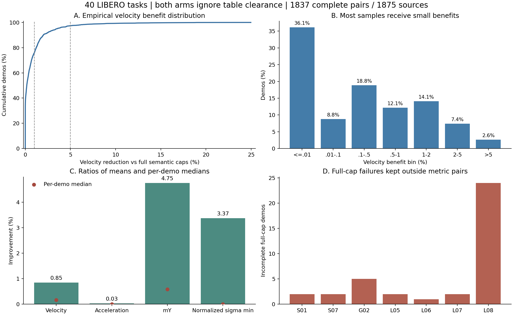
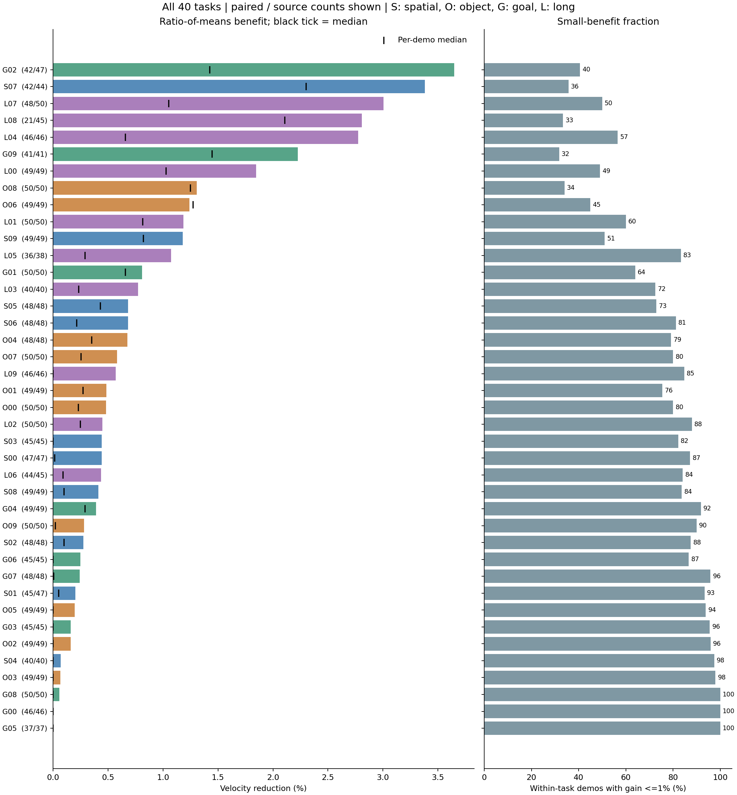

# 全40任务：无净空条件下，全开初始化与搜索最优的运动学对照

状态：2026-11-09，全部只读统计及独立来源/选点/聚合复核完成。未新跑搜索、仿真、训练或物理任务；原始标签、冻结请求、成败候选和用户暂停的训练全部保留。

优先检查样本见[FOCUS_CASES.md](FOCUS_CASES.md)：全部38条全开失败编号、14条搜索降速>10%的代价样本，以及速度收益较小但σmin/mY变化较大的样本；每条原trial地址和SHA见focus_cases.json。

核心结果：1875条全部覆盖，最大语义全开有38条未完整通过；共同完整1837条中，搜索最优较全开平均关节速度降低0.850%，逐条中位数0.167%，1394/1837=75.88%的收益≤1%。

## 比较对象和分母

两组都取消桌面相对净空与绝对桌面接触验收，但保留完整运动学可解、自碰撞等非桌面验收。全开组根据prepared_input重建最大点并匹配每块原初始化候选，APP/EXEC各轴使用原手工5°/15°/30°上限、双向全开，严格轴仍0。搜索组在相同已采样候选中按实际观测平均关节速度最小选择，包含初始化和16次贝叶斯追加；其他运动学指标没有参与选点。

原1875批次中1851条标签与新补标24条合计1875条、40任务、2301个独立标注块；核对57375条候选元数据与原独立审计SHA，读取验证4358份去重trial。补标24采用允许失败零基线几何观测的协议，候选仍为相同IPOPT20/EMA10、cache85正常回放；该协议差异保留为单独分层，不冒称同协议重复实验。原Long02/demo40的GP线搜索数值恢复亦单列敏感性。

全开完整1837/1875（97.97%），搜索最优完整1875/1875。全开38条失败分为36条optimizer_infeasible、2条robot_self_collision。36条求解拒绝的原hard_failure_details全部是IPOPT达到20次迭代上限，发生于postgrasp 26条、release 7条、grasp 3条；不能将其视为严格不可达证明。这是已有候选内的执行完整率，不是LIBERO物理任务成功率。尤其L08双摩卡壶上炉有24/45全开失败，只剩21条数值配对。完整失败清单见[FULL_INCOMPLETE.md](FULL_INCOMPLETE.md)，求解状态与逐帧证据见full_failure_diagnosis.json。

## 全体运动学指标与分布

每demo内速度/加速度/jerk按独立块N−1/N−2/N−3加权，mY按N加权；最小奇异值取块间最小，关节路程求和。不拼接独立初始化的块、不虚构跨块差分；demo间等权。百分比均值比=两个总体均值之比的改善，逐条分位数来自每条自身的相对改善。正数为改善，负数为退化。

|指标|全开均值|搜索最优均值|均值比改善|逐条中位数|P05—P95改善|变化绝对值≤1%|恶化>1%|
|---|---:|---:|---:|---:|---:|---:|---:|
|平均关节速度↓ rad/s|0.520417|0.515991|+0.8505%|+0.1674%|-0.000%—+3.504%|1394/1837 (75.88%)|0/1837 (0.00%)|
|平均关节加速度↓ rad/s²|3.902734|3.901596|+0.0292%|+0.0000%|-3.993%—+3.826%|1193/1837 (64.94%)|405/1837 (22.05%)|
|平均关节jerk↓ rad/s³|123.068738|123.155183|-0.0702%|+0.0000%|-4.530%—+3.987%|1168/1837 (63.58%)|427/1837 (23.24%)|
|平均可操作度mY↑|0.076272|0.079898|+4.7539%|+0.5848%|-0.010%—+21.318%|952/1837 (51.82%)|16/1837 (0.87%)|
|速度能力归一化最小σ↑|1.135005|1.173245|+3.3692%|+0.0000%|-5.055%—+33.483%|992/1837 (54.00%)|222/1837 (12.08%)|
|原始几何Jacobian最小σ↑|0.141468|0.141384|-0.0593%|-0.0000%|-9.947%—+22.265%|1032/1837 (56.18%)|555/1837 (30.21%)|
|关节路程↓ rad|4.135686|4.098689|+0.8946%|+0.1160%|-0.000%—+3.329%|1437/1837 (78.23%)|5/1837 (0.27%)|

速度降低表示相同动作时序下关节运动量减小，不是执行时长变短。搜索只优化速度，因此加速度/jerk可以恶化；平均加速度接近不变，并不意味着每条都接近不变。归一化σ和原始σ对应不同Jacobian尺度，不可混作同一个指标。

|速度额外收益阈值|样本数/1837|比例|
|---|---:|---:|
|≤0.01%|664/1837|36.15%|
|≤0.1%|825/1837|44.91%|
|≤0.5%|1171/1837|63.75%|
|≤1%|1394/1837|75.88%|
|≤2%|1653/1837|89.98%|
|≤5%|1789/1837|97.39%|
|≤10%|1823/1837|99.24%|

收益>5%的仅48/1837（2.61%），>10%的14/1837（0.76%）。按绝对关节速度节省排序，前1%样本贡献19.63%，前5%贡献45.89%，前10%贡献61.76%；平均数存在明显长尾。

## 初始化择优与追加搜索的贡献

只在结构化初始化中择优，平均速度从0.520417降至0.516570rad/s，改善0.7392%；加上16次追加查询后为0.515991rad/s，相对初始化最优再降0.1121%。

初始化择优已经贡献总绝对速度收益的86.92%。追加查询收益≤0.1%的1552/1837（84.49%），≤1%的1786/1837（97.22%）；逐条追加收益中位数0.00003438%。尽管1277条至少有一块最终选中追加候选，候选来源不能替代真实收益大小。

追加查询相对初始化最优收益较高的任务为S09（0.748%）、S06（0.579%）、S07（0.425%）；这些任务也未显示所有样本都需要追加查询。

## 哪些任务拉高总体差异

40任务中28个任务的速度均值改善≤1%，32个任务的逐条中位数≤1%。以下按绝对速度节省贡献排序，而非按容易受分母影响的逐条百分比排序：

|任务|简述|配对/来源|速度均值比改善|逐条中位数|总速度节省贡献|剔除此任务后的整体改善|
|---|---|---:|---:|---:|---:|---:|
|G02|酒瓶放柜顶|42/47|3.647%|1.424%|12.79%|0.764%|
|S07|炉子上取碗|42/44|3.382%|2.303%|9.47%|0.789%|
|L07|汤罐和奶酪进篮|48/50|3.004%|1.053%|7.87%|0.801%|
|G09|酒瓶放架上|41/41|2.225%|1.446%|7.53%|0.810%|
|L04|白杯左盘、黄白杯右盘|46/46|2.774%|0.658%|6.26%|0.813%|

这5个任务贡献43.92%的绝对速度节省；剔除它们后整体改善从0.850%降为0.544%。前3个贡献30.13%，前10个贡献63.05%。任务分组对应约23.08%的逐条百分比方差，其余仍是任务内部差异，不能把全部长尾归因于任务名称。

特殊情况：L08双摩卡壶上炉的24/45条全开不完整，独占38条全开失败中的24条；其余21条平均降速2.809%，这是有条件的幸存配对统计。L04双杯分放左右盘均值2.774%、中位数0.658%，最高demo_14达到24.961%，明显由少数样本拉高。G00/G05两任务共83条为严格零域，两组完全一致；剔除后1754条仍有74.74%的速度收益≤1%，总体改善0.899%，主要结论保持。

完整40任务表及每任务独立文字分析见[PER_TASK.md](PER_TASK.md)，包含四项指标、低收益比例、尾部分位数、全开失败、初始化/追加贡献和剔除敏感性。机器可读表见[per_task.csv](per_task.csv)。

## 分层与数值尾部

|来源/敏感性|总来源|配对|速度均值改善|
|---|---:|---:|---:|
|原1851|1851|1818|0.8430%|
|后续补标24|24|19|1.4672%|
|合并1875|1875|1837|0.8505%|
|排除严格零域|1792|1754|0.8990%|
|排除GP恢复1条|1874|1836|0.8507%|

归一化最小σ的逐条改善百分比均值11.15%，但中位数仅约0.000016%，两总体均值之比提高3.37%。L08/demo30全开σ=0.00795676，搜索后0.498871，逐条比值达+6169.77%；该百分比受到很小分母放大。排除全开σ<0.05的4条后，均值比仍为+3.346%，说明个别巨大百分比不能当作典型收益，但均值改善也不完全由这4条造成。完整绝对值及分位数见summary.json、tail_diagnostics.json。

## 验证、范围和本地绝对源地址

独立复核检查10416份原文件SHA、重新读取4358份raw trial，重建2301个块的全开点及无净空最优，复算全部7项聚合、1837条配对CSV的均值/中位数/阈值/退化计数和40任务速度汇总。详见verification.json及verification.log。

这是原净空感知BO已经采样的候选内比较。重新删除净空后从头搜索会改变采样点，本次没有测量；本次也不输出新的物理任务成功率。不同标注块各自初始化，不能当作连续物理长任务验证。旧协议中的全零/非零姿态参考衔接差异仍保留，未通过改SHA或改代码消除。

上次Spatial00的3.11%是“原净空合格最优→去净空最优”；本报告是“语义最大值全开→去净空最优”，两边都不筛净空，分母与对照组不同。当前S00的此项速度改善为0.442%，没有矛盾。

- 原始1875请求、候选、标注、原独立审计、source_snapshot与日志根：`/media/czl/sata/franka_my_code/franka_mujoco/analysis_results/libero_relative_clearance_eps01_ema85_full1875_20261107`。逐demo为`<suite>/task_XX/demo_N/{prepared_input.json,tolerance_labels.json,subtask_*/annotation.json,subtask_*/evaluations/<hash>/trial.json}`；配置`annotation_request.json`、`selection.json`、`authored_tolerances_deg.json`；审计`annotation_independent_final_audit.json`；日志`annotation.log`、`pipeline.log`和各demo/search.log。

- 补标24请求/结果/独立审计/源码/日志根：`/media/czl/sata/franka_my_code/franka_mujoco/analysis_results/libero_missing24_baseline_observation_20261109`，同样的逐demo结构；`annotation_request.json`保留baseline observation差异，`annotation_independent_final_audit.json`审计24条，`pipeline.log`、`independent_audit.log`与各demo/search.log保留。

- 名义物理逐回合视频/轨迹/状态原位根：`/media/czl/sata/franka_my_code/openpi/data/libero_tasktol_joint_servo/20261025_success10_v1/episodes`与`/media/czl/sata/franka_my_code/openpi/data/libero_tasktol_joint_servo/20261101_full_v1/episodes`。每条精确source_folder在本目录episodes.json，可核对其`trajectory.json`、`states.npz`、`report.json`及双相机视频；离线候选没有新物理视频，未复制原始数据。

- 本次分析根：`/media/czl/sata/franka_my_code/openpi/experiment_records/2026-11-09_libero_alltasks_noclearance_full_vs_best`。`analyze.py`入口、`analysis.log`过程、`episodes.json`逐demo/块/候选路径及SHA/指标、`summary.json`全部统计、`per_demo.csv`逐条7指标、`per_task.csv`40任务、`sources.json`全部读取文件绝对路径和SHA、`verify.py`与`verification.json`/`verification.log`复核、`report.py`文档和图表生成。

- 未使用远端主机、不运行模型推理、不训练、不上传、不恢复用户暂停的其他工作。
