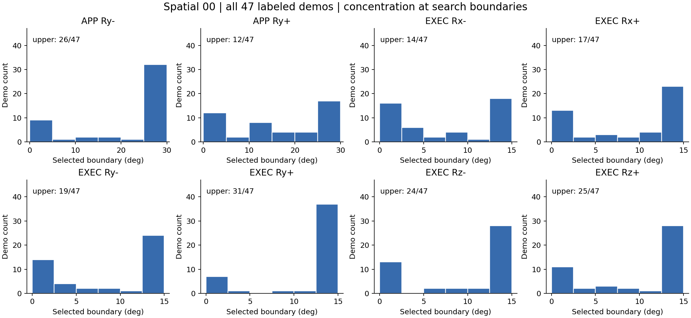
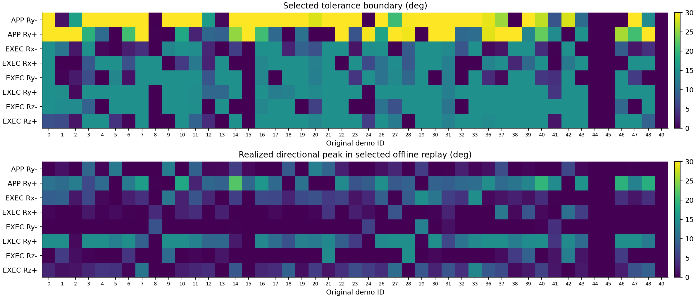

# Spatial00：同任务全部demo的容差标签分布

状态：2026-11-09，只读统计、来源SHA核对及独立统计复算完成。未启动训练、搜索、物理回放或评测；未改写任何原始标注、轨迹、视频或冻结请求。

续分析：[中位数、中央集中度及两类极端样本](CENTRAL_EXTREMES.md)。标注/实际峰值在各自中位数±5°内覆盖55.32%/80.59%；标注偏离中心最大的5条为demo44/45/49/15/8，实际为demo29/42/8/9/21，重复向量去重后的补充名单单列。统计基于同一47条与原离线峰值来源。

搜索过程诊断：[为何APP Ry有些demo接近零](PRE_RY_DIAGNOSIS.md)。15/47至少一侧≤1°，其中4条双侧近零；9条已有该侧>1°的合格候选，归零来自候选速度排名；44/45/49仅第0个全零候选合格，另外27条全部因相对净空失败。核对1316条查询元数据与602份原trial，逐帧重算净空瓶颈；全零与非零还存在阶段参考策略差异，不能将零标签解释为真实Ry最大可行容差为零。

去净空对照：[在既有候选中取消净空验收重排](WITHOUT_CLEARANCE.md)。28/47换候选，标注/实际峰值至少一方向变化≥5°为27/18条，仅APP Ry为18/9条；平均关节速度0.701074→0.679236rad/s，较原方案再降低3.11%。原APP双侧近零4条均恢复明显释放，组均值再降16.63%。仅重排原候选，未重搜、回放或改正式标签。

## 目的、样本与协议

任务：`pick_up_the_black_bowl_between_the_plate_and_the_ramekin_and_place_it_on_the_plate`，对应`libero_spatial/task_00`。

以最新版完整1875标注母集为主，覆盖该任务全部47条有效标签，而非前5条或仅保留新容差物理回放成功条目。原始HDF5有50条demo，25、34、35未进入本次成功重构母集；不能给这3条补零标签，也不能把47条当作50条。该任务47条均有有效标签，没有在本次诊断中重测或按成败筛选。

这里的样本编号为原始演示`demo_N`，并非模型闭环评测的rollout seed。标注搜索另有独立种子：冻结`dsp.py`使用`stable_seed(20261105, suite, task_id, demo, subtask_index)`。

沿用2026-11-07冻结协议：cache85新版EMA、IPOPT20、20Hz、EMA权重10；结构化初始候选后每块追加16次贝叶斯查询。候选完整可解且每帧机器人/支撑面净空不比本demo零容差参考降低超过0.1mm时可接受，目标是在可接受候选中选取平均关节速度最低者。本次只读取已提交结果。离线执行仅含机器人、自碰撞及支撑面，无任务物体、无物理步进；这些标签不能当作经过任务物体接触成功验证的最大容差。

每demo该任务恰有1个观察周期。APP允许Ry±，上限30°；EXEC允许Rx/Ry/Rz各正负方向，上限15°。APP的Rx/Rz严格为0；其余严格阶段逐帧值为0，单独检查而不混进可释放方向分布。逐帧标签单位rad，本文统一换算为度。每个阶段内边界是常量，阶段切换时变化；不同demo长度74–167帧，本分析每demo等权，避免长轨迹重复计数。

## 结果

分布为明显的端点堆积，加上区间内的分散取值。全部376个可释放边界值（47×8）中，69个为0，168个等于手工上限，合计237/376=63.03%；其余139个在区间内。端点判定绝对容差1e-6度。未进行正态性检验或拟合某个参数分布。

|阶段/方向|均值±总体标准差|中位数|范围|等于0|等于上限|
|---|---:|---:|---:|---:|---:|
|APP Ry−|22.06±11.85°|30.00°|0–30°|6/47|26/47|
|APP Ry+|16.29±11.73°|17.46°|0–30°|10/47|12/47|
|EXEC Rx−|7.59±6.34°|7.43°|0–15°|6/47|14/47|
|EXEC Rx+|9.05±6.40°|12.12°|0–15°|13/47|17/47|
|EXEC Ry−|8.86±6.46°|12.85°|0–15°|10/47|19/47|
|EXEC Ry+|12.19±5.36°|15.00°|0–15°|4/47|31/47|
|EXEC Rz−|10.07±6.53°|15.00°|0–15°|12/47|24/47|
|EXEC Rz+|10.21±6.20°|15.00°|0–15°|8/47|25/47|

每个方向均出现0和最大上限。对47条demo的1081对两两组合计算绝对差，再对8个方向等权平均，边界平均差8.016°，实际离线释放峰值平均差4.041°；边界平均极差18.75°，实际峰值平均极差14.81°。峰值来自各demo选中候选的离线运动学回放，未混入后续连续物理回放。

## 场景接近，为何边界仍不同

从原始HDF5的初始化状态读取位置，以原始XML的关节顺序解码qpos；核对初始化属性与首帧状态一致，未启动MuJoCo。目标碗`akita_black_bowl_1`初始x/y位置标准差10.19/9.73mm，跨度48.53/38.30mm；盘子x/y标准差9.88/8.57mm。因此场景布局确实接近，但并非完全相同。这里只量化位置，没有分析初始朝向与标签的相关性。

边界差异并不能全归因于这约1cm的摆放变化。标签由每demo自己的名义轨迹、阶段时序、零容差净空参考、固定随机种子和有限搜索预算共同决定。它表示本轮搜索中速度最好的合格候选边界，并非只由任务名字或单张初始图决定的唯一几何真值；也没有证明是最大可行边界。

有些边界对实际运动约束很弱：EXEC Ry−边界均值8.86°，但实际释放峰值40/47条为0°，其实际峰值均值仅0.68°。类似地，EXEC Rz−边界均值10.07°，实际峰值29/47条为0°。边界不同不等于机器人真的使用了这么大的不同旋转。

已有候选还提供了目标近似平坦的直接例子：上限全开在19/47条中通过离线验收，其中12条的选中候选较全开速度收益不超过0.1%，17条不超过1%。demo_0选中EXEC Rz+为7.3893°，全开为15°；两者平均速度只相差约0.0000252%。这支持部分边界不唯一、未被实际运动充分使用的解释；不能据此把全部跨demo差异都判作搜索噪声。其余28条上限全开未通过验收，不用这些近似平坦样本替代它们。

## 数据版本之间的关系

- 原始LIBERO HDF5和零容差名义重构来源本身没有这套搜索容差真值。手工语义表给允许释放的轴和最大搜索范围。
- 当前全量标注是独立重标的47条；2026-11-06旧前5条不是另外5个新场景。同源demo_0–4在两个版本间，8方向绝对差均值4.351°，最大26.233°。其间EMA采样实现等发生变化，这是协议版本差异，不能作为同协议重复搜索的随机误差估计，也不混为52条独立样本。
- 当前20261107物理回放数据集从上述标签来源读取边界，plan逐条绑定SHA；并非对每条回放重新标注。后续物理执行表现与离线候选实际释放是不同结果。
- 已退役固定30°组是旧手工规则实验，不能作为本次搜索真值总体的一部分。

结论适用范围为该任务现有47条标注及同源旧前5版本比较。未控制相同轨迹/相同搜索种子重新运行，因此没有把场景、轨迹、搜索随机性、协议改动对差异的贡献分别量化；也不从此任务推断全部40任务具有相同分布。

## 本地源数据地址、产物与验证

- 最新标注根：`/media/czl/sata/franka_my_code/franka_mujoco/analysis_results/libero_relative_clearance_eps01_ema85_full1875_20261107`；本任务为其`libero_spatial/task_00/demo_N/`。每条的`prepared_input.json`、`tolerance_labels.json`、`subtask_00/annotation.json`、`subtask_00/evaluations/<hash>/trial.json`保留原位。精确绝对地址和读取时SHA见本目录`sources.json`，逐demo统计见`details.json`。
- 冻结请求/选样/语义上限：上述根目录的`annotation_request.json`、`selection.json`、`authored_tolerances_deg.json`；执行与历史审计日志：`annotation.log`、`pipeline.log`、`independent_audit.log`。独立执行审计：`annotation_independent_final_audit.json`，本次核对其SHA与物理回放plan绑定一致，逐条核对47份标签SHA、prepared SHA及选中候选SHA。
- 原始演示HDF5：`/media/czl/sata/franka_my_code/openpi/third_party/libero/libero/datasets/libero_spatial/pick_up_the_black_bowl_between_the_plate_and_the_ramekin_and_place_it_on_the_plate_demo.hdf5`。本次只读初始化状态；视频/名义轨迹原位根为`/media/czl/sata/franka_my_code/openpi/data/libero_tasktol_joint_servo/20261025_success10_v1/episodes/libero_spatial/00`及`/media/czl/sata/franka_my_code/openpi/data/libero_tasktol_joint_servo/20261101_full_v1/episodes/libero_spatial/00`，每demo精确来源见`details.json`中的`source_folder`。
- 当前物理回放配置：`/media/czl/sata/franka_my_code/openpi/data/libero_tasktol_joint_servo/20261107_annotated_tolerance_v1/plan.json`；物理轨迹/视频：该根目录`episodes/libero_spatial/00/demo_N/{trajectory.json,states.npz,report.json,main_rgb.mp4,wrist_rgb.mp4}`；结果/审计/日志为该根目录`summary.json`、`independent_final_audit.json`、`generation.log`、`auditing.log`。这些是来源关系证据，本次未以物理回放成败重新筛选标签。
- 旧前5标注：`/media/czl/sata/franka_my_code/franka_mujoco/analysis_results/libero_relative_clearance_eps01_dsp16_first5pertask_20261106/libero_spatial/task_00/demo_N/`，SHA及所用候选地址同列`sources.json`。
- 本次分析脚本：`/media/czl/sata/franka_my_code/openpi/experiment_records/2026-11-09_libero_spatial00_label_distribution/analyze.py`；统计结果：同目录`summary.json`、`details.json`、`per_demo.csv`、`distribution.png`、`heatmap.png`；独立复算入口`verify.py`，结果`verification.json`。验证覆盖来源SHA、全部逐帧边界和严格阶段、47×8组边界/峰值统计及每方向1081对绝对差；两张图已目视检查。
- 不涉及策略模型版本、服务器或训练seed；无新增失败回合与重测。该目录只保存总结、统计及小型图表，未复制原始轨迹/视频/数据集。
