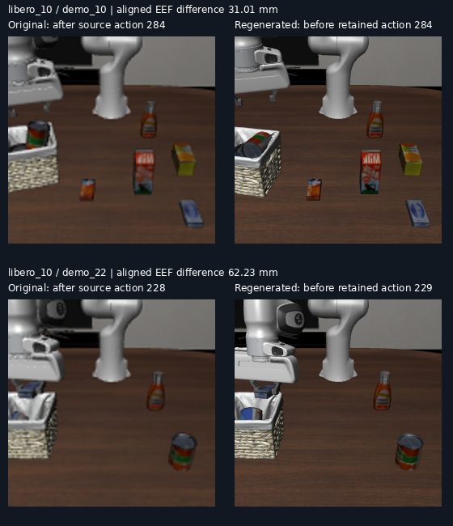

# 原始 LIBERO 与 OpenVLA 重录数据核查

核查日期：2026-10-20。仅读取已有 HDF5、运行元数据和查看器目录；未启动仿真、未修改源数据或标注。

追加官方发布版对照已完成，见 [OFFICIAL_COMPARISON.md](OFFICIAL_COMPARISON.md)：官方保留 1693 条，本地 1699 条；16 条匹配样本中，15 条的本地对官方最大末端差小于 1 mm，最差 1.278 mm。官方样本对原始记录也出现最大 83.959 mm 的差异。因此下文“重录不等于原始”的发现不能单独用来判断本机环境异常；本地旧环境重录在这些样本中与官方接近。

## 结论

此前重录不是逐帧恢复原始状态再渲染，而是恢复首个状态、执行 10 次稳定动作，再执行经过 no-op 过滤的原始动作。被过滤的动作不参与物理步进。这沿用本地保留的 OpenVLA 上游脚本语义，但不保证重现原始轨迹。

40 个任务的记录均使用 Python 3.8.20、MuJoCo 3.2.3、robosuite 1.4.1、NumPy 1.22.4。2000 条示范中，1699 条在重录结束时通过成功判定，301 条失败。失败记录保留在元数据中，失败轨迹未写入处理后训练 episode。

网页的 400 条视频从处理后 HDF5 的 agentview 图像编码，40 条主示范视频复用既有导出；没有调用 MuJoCo 3.10 重新物理回放。页面中的末端和关节曲线也来自同一次处理后的观测。视频与这些曲线共享来源，但它们不等同于原始示范。

## 动作与观测对齐

本地 LIBERO `scripts/create_dataset.py` 在 `env.step(action)` 后存储原始观测。OpenVLA 重录在执行动作前存储观测。因此不能直接用相同图像数组下标计算误差。

本次比较 `regenerated.obs[i+1]` 与 `original.obs[source_step_indices[i]]`，即对应同一源动作执行后的状态。重录最后一次动作之后没有保存图像，因此该动作未参与末端观测统计。所有 1699 条已保存示范中，原始 `obs/joint_states[j]` 与原始 `states[j+1]` 的机械臂关节位置完全一致，支持该动作后约定；重录保留的动作与索引对应原始动作也全部完全一致。

## 已测量差异

每条轨迹先取其对应帧的最大末端位置差，再对这些最大值统计：

| 范围 | 条数 | 最大差的中位数 | 全范围最大差 | 最大差超过 10 mm 的条数 |
|---|---:|---:|---:|---:|
| 所有已保存重录 | 1699 | 8.883 mm | 276.869 mm | 727 |
| 网页所选示范 | 400 | 8.601 mm | 79.551 mm | 163 |
| 标注使用的主示范 | 40 | 7.826 mm | 62.225 mm | 13 |

这测量的是原始记录与重录之间的对应动作后轨迹差，包含稳定动作、跳过 no-op 的步进、控制器恢复历史以及相对原始采集环境的差别，不能全部归因于某个 MuJoCo 版本。末端位置差也不能直接当作物体位置差。

正在讨论的 `libero_10 / LIVING_ROOM_SCENE2_put_both_the_alphabet_soup_and_the_tomato_sauce_in_the_basket / demo_10`：重录保留 285 个动作、过滤 1 个 no-op；284 对可比较的动作后末端观测，最大差 31.012 mm、中位数 11.592 mm。该条重录通过成功判定。

前一轮约 60 mm 的结果是“MuJoCo 3.2.3 重新执行示范”与“MuJoCo 3.10 重新执行示范”的比较，并不是以原始 HDF5 轨迹为真值。这两个基线需要分开标记。

## 方法与环境的责任边界

追加分层统计：1699 条已保存重录中，1492 条没有过滤任何 no-op，其中仍有 647 条的对应动作后末端最大位置差超过 10 mm；这 1492 条的单条最大差中位数为 9.051 mm。因此不能将偏差全部归因于 no-op 过滤。这不是随机对照，不能用两个子群的差异估计过滤的因果效应。

OpenVLA 保留的上游脚本与本地入口都执行 10 次稳定动作并按最终成功筛选，它们没有保证原始轨迹逐帧等价。原始 LIBERO 的本地数据生成脚本还按示范 model_file 恢复模型；OpenVLA 路径按 BDDL 构建环境后恢复首个扁平状态，没有按每条示范 XML 重建模型。模型编译结果、控制器内部状态和接触求解历史是否与采集时一致，仍须针对性验证。

现有证据证明重录不保真，尚不能证明本机 LIBERO 安装错误，也不足以认定全部偏差来自 OpenVLA 的某一项操作。将成功重录当作原始示范的精确可视化基线，是本次材料制备与验证范围上的不足；用于生成重新验证成功的训练示范与用于精确还原原始证据应分开。

## 对现有标注的含义

现有 mask 的直接视觉证据来自重录视频中的实际操作。它们可以作为重录示范上的语义预测记录，但不能声称已经验证适用于原始示范的每个抓取接触和阶段边界。若后续容差轨迹针对原始示范，应基于原始证据复核差异较大的主示范；本次不覆盖冻结标注。

## 留存记录

- `audit.py`：可复现的只读核查脚本，使用项目 `.venv/bin/python` 执行。
- `audit.json`：40 个任务统计、1699 条示范逐条差异、运行版本和脚本 SHA256。
- `original_vs_regenerated.png`：两条主示范在最大末端差对应动作之后的主视角并排图。原始图像缩放到相同显示尺寸；只用于查看场景差异，不用于像素误差统计。

